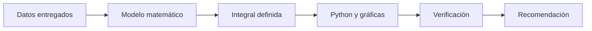

# Proyecto 2 — Modelación con integración

  

Proyecto individual del curso **MA-0321 Cálculo Diferencial e Integral**, Universidad de Costa Rica, II ciclo 2026.

Cada entrega incluye un informe PDF y una hoja de cálculo con los datos y cálculos. La evaluación corresponde a **60 puntos de trabajo escrito** y **40 puntos de defensa**. La fecha de entrega indicada es el **miércoles 18 de noviembre de 2026**.

## Modelo matemático común

Para cada caso se estudia una magnitud variable $f(t)$ durante un intervalo $[a,b]$. La cantidad acumulada se representa mediante:

$$
A(a,b)=\int_a^b f(t)\,dt
$$

Cuando se necesita comparar periodos de distinta duración, se utiliza el valor promedio:

$$
\overline{f}=\frac{1}{b-a}\int_a^b f(t)\,dt
$$

La recomendación se obtiene comparando una función de decisión $J(x)$, sujeta a las restricciones del problema:

$$
x^*=\operatorname*{arg\,max}_{x\in\mathcal{D}}J(x)
\qquad\text{o}\qquad
x^*=\operatorname*{arg\,min}_{x\in\mathcal{D}}J(x)
$$

Los parámetros, límites de integración y funciones específicas de cada caso se encuentran en su informe PDF y en su hoja de cálculo.

## Entregas

| Código | Estudiante | Proyecto y tema | Pregunta de decisión |
| --- | --- | --- | --- |
| C-02 | María Marcelle Fernández Vilchez | 1. Somnolencia al volante en la ruta Golfito–San José | ¿Qué umbral del índice de bandas debe usar la diadema para activar la alarma? |
| C-09 | Kendall Fabricio Villalobos Villalta | 2. Cafeína, atención y sueño en semana de exámenes | ¿Cuántas tomas, de qué bebida y hasta qué hora conviene consumir cafeína sin afectar el sueño? |
| C-03 | Jeremy Fabrizio Fonseca Araya | 3. Amenaza sísmica y reforzamiento del Hospital de Golfito | ¿Conviene reforzar el pabellón, con cuál opción y cuánta pérdida anual se elimina por colón invertido? |
| C-07 | María Angel Sanarrusia Gomez | 4. Gases del volcán Poás y cierre preventivo del mirador | ¿Qué regla reduce más la exposición sin cerrar innecesariamente? |
| C-10 | Luis Altamirano Elizondo | 5. Procrastinación y entregas de tareas en Mediación Virtual | ¿Qué estrategia contra la procrastinación debe aplicarse el próximo semestre? |
| C-06 | Allison Georgina Monge Navarro | 6. Migración de aves rapaces sobre Këköldi, Talamanca | ¿Qué fechas y horario permiten registrar más aves migratorias? |
| C-05 | Dennis Junior Jimenez Venegas | 7. Estrés térmico de los arrecifes del Golfo Dulce | ¿En qué sitio invertir la restauración y en qué meses activar alertas? |
| C-04 | Joseph Steven Hernandez Torrentes | 8. Energía de las olas para una boya frente a Pavones | ¿Qué combinación de convertidor y batería mantiene la boya operativa al menos 99 % del tiempo? |
| C-01 | Emma Sofia Aguirre Torres | 9. Repotenciación de la Planta Eólica Tejona en Tilarán | ¿Conviene repotenciar, con cuál opción o mantener las turbinas actuales? |
| C-08 | Isaac Alexander Vega Orozco | 10. Ruido de embarcaciones y ballenas jorobadas en el Golfo Dulce | ¿Qué medida reduce el ruido recibido con el menor costo? |

## Evaluación

- **Trabajo escrito, 60 puntos:** problema, datos y modelo; integración y corrección matemática; código en Python, gráficas y aplicación; resultados, verificación y recomendación.
- **Defensa, 40 puntos:** dominio del problema y modelo; explicación de la integral y del código; respuestas y decisión final.

## Revisión

1. Seleccionar al estudiante en la tabla o en su carpeta.
2. Leer su README individual y el informe PDF.
3. Abrir la hoja `.xlsx` correspondiente para revisar los datos y cálculos.

## Carpetas individuales

Cada estudiante tiene un README con su tema, pregunta de decisión, objetivo, archivos y forma de revisión.

## Flujo de trabajo

