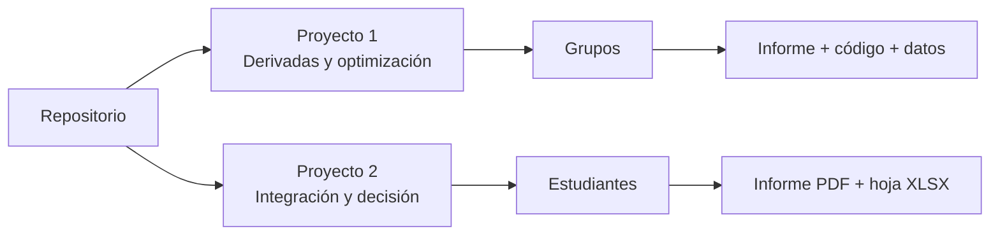

# Proyectos de Cálculo Diferencial e Integral

  

Repositorio académico del curso **MA-0321 Cálculo Diferencial e Integral**, Universidad de Costa Rica, Escuela de Matemática, II ciclo 2026.

> **Portafolio académico** · Modelar · Calcular · Interpretar · Decidir

## Proyectos

| Proyecto | Descripción | Documentación |
| --- | --- | --- |
| Proyecto 1 | Aplicaciones de derivadas, límites y optimización en problemas empresariales. | [Abrir Proyecto 1](PROYECTO_1/README.md) |
| Proyecto 2 | Modelación con integración para resolver problemas de decisión a partir de datos entregados. | [Abrir Proyecto 2](PROYECTO_2/README.md) |

## Estructura

```text
PROYECTOS_CALCULO_DIFERENCIAL_E_INTEGRAL/
├── README.md
├── PROYECTO_1/
│   ├── README.md
│   └── carpetas de los grupos
└── PROYECTO_2/
    ├── README.md
    └── carpetas de los estudiantes
```

Consulta cada README para conocer los integrantes, temas, archivos y forma de revisión de las entregas.

## Ruta de revisión


